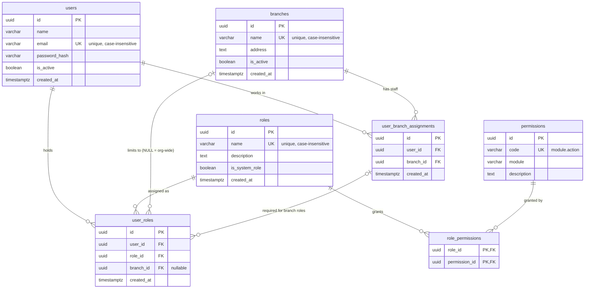

# RBAC and branch access — database design

Scope: who can do what, and in which branch. Single business (no `tenant_id`).
PostgreSQL 15+.

The full, runnable table definitions and seed data are in [rbac-schema.sql](rbac-schema.sql).

## How it fits together

- A **user** works in one or more **branches** (`user_branch_assignments`).
- A user holds one or more **roles** (`user_roles`). Each role assignment is either:
  - **organization-wide** (`branch_id` is NULL) — applies in every branch, e.g. Owner, Admin;
  - **branch-restricted** (`branch_id` set) — applies only in that branch, e.g. Cashier in Marina.
- A **role** is a named set of **permissions** (`role_permissions`). Roles are shared by all
  branches; the branch is chosen when the role is *assigned*, not when it is created.
- A **permission** is one action the application checks, e.g. `orders.create`.

So: **user → (role, in branch or everywhere) → permissions.**



## Cardinalities

| Relationship | Type | Through |
|---|---|---|
| users ↔ roles | many-to-many | `user_roles` |
| roles ↔ permissions | many-to-many | `role_permissions` |
| users ↔ branches | many-to-many | `user_branch_assignments` |
| branches → user_roles | one-to-many, optional (`branch_id` NULL = org-wide) | `user_roles.branch_id` |
| user_branch_assignments → user_roles | one-to-many, optional | composite FK `(user_id, branch_id)` |

## Keys and constraints

| Table | Primary key | Foreign keys (on delete) | Unique | Other |
|---|---|---|---|---|
| `users` | `id` | — | `lower(email)` | |
| `branches` | `id` | — | `lower(name)` | |
| `roles` | `id` | — | `lower(name)` | |
| `permissions` | `id` | — | `code` | `code` must look like `module.action` |
| `role_permissions` | `(role_id, permission_id)` | role → **cascade**, permission → **cascade** | (the PK) | index on `permission_id` |
| `user_branch_assignments` | `id` | user → **cascade**, branch → **restrict** | `(user_id, branch_id)` | index on `branch_id` |
| `user_roles` | `id` | user → **cascade**, role → **restrict**, branch → **restrict**, `(user_id, branch_id)` → assignment **cascade** | `(user_id, role_id, branch_id)` **NULLS NOT DISTINCT** | index on `role_id`; partial index on `branch_id` |

What these give you:

- **No duplicates.** A user can't be assigned to the same branch twice, or get the same role
  twice in the same branch. `NULLS NOT DISTINCT` also blocks the same organization-wide role
  twice — a plain `UNIQUE` would allow it, because it treats NULLs as different.
- **Branch roles need a branch assignment.** The composite foreign key
  `user_roles (user_id, branch_id) → user_branch_assignments (user_id, branch_id)` rejects
  "Cashier in Marina" for someone not assigned to Marina. It is skipped when `branch_id` is NULL,
  so organization-wide roles are unaffected.
- **Removing someone from a branch removes their roles there** (cascade through that key).
- **In-use data is protected.** A role that is assigned, or a branch that has staff, can't be
  deleted (restrict). Deactivate branches with `is_active = false` instead.
- **Case-insensitive names.** `Ali@Shop.com` and `ali@shop.com` are the same email; `cashier`
  can't be created next to `Cashier`.

## Default roles and permissions

All seven default roles are `is_system_role = true`: the application must not let anyone delete
or rename them (an application rule, not a database rule). Roles created later are `false`.

Typical scope: **Owner** and **Admin** are assigned organization-wide; the others per branch.

Starting permission set (seeded; editable later):

| Permission | Owner | Admin | Branch Manager | Receptionist | Cashier | Laundry Staff | Delivery Staff |
|---|:-:|:-:|:-:|:-:|:-:|:-:|:-:|
| `branches.manage` | ✓ | ✓ | | | | | |
| `users.manage` | ✓ | ✓ | | | | | |
| `roles.manage` | ✓ | ✓ | | | | | |
| `dashboard.view` | ✓ | ✓ | ✓ | ✓ | ✓ | | |
| `orders.view` | ✓ | ✓ | ✓ | ✓ | ✓ | ✓ | ✓ |
| `orders.create` | ✓ | ✓ | ✓ | ✓ | | | |
| `orders.edit` | ✓ | ✓ | ✓ | ✓ | | | |
| `orders.delete` | ✓ | ✓ | ✓ | | | | |
| `orders.update_status` | ✓ | ✓ | ✓ | | ✓ | ✓ | |
| `payments.take` | ✓ | ✓ | ✓ | ✓ | ✓ | | |
| `payments.discount` | ✓ | ✓ | ✓ | | ✓ | | |
| `payments.refund` | ✓ | ✓ | ✓ | | | | |
| `customers.view` | ✓ | ✓ | ✓ | ✓ | ✓ | | ✓ |
| `customers.create` | ✓ | ✓ | ✓ | ✓ | | | |
| `customers.edit` | ✓ | ✓ | ✓ | ✓ | | | |
| `customers.delete` | ✓ | ✓ | ✓ | | | | |
| `products.view` | ✓ | ✓ | ✓ | ✓ | | | |
| `products.manage` | ✓ | ✓ | | | | | |
| `deliveries.view` | ✓ | ✓ | ✓ | | | | ✓ |
| `deliveries.update` | ✓ | ✓ | | | | | ✓ |
| `reports.view` | ✓ | ✓ | ✓ | | | | |

## Reading access from the schema

For an active user in an active branch **B**, their permissions are the union of:

1. permissions of their **organization-wide** roles (`branch_id IS NULL`), and
2. permissions of their roles **in B** (`branch_id = B`).

Branches the user can work in: every active branch if they hold any organization-wide role,
otherwise the active branches in `user_branch_assignments`. Being assigned to a branch with no
role there gives no permissions in it.

Example — does a user have `orders.delete` in a branch?

```sql
SELECT EXISTS (
    SELECT 1
    FROM user_roles ur
    JOIN role_permissions rp ON rp.role_id = ur.role_id
    JOIN permissions p       ON p.id = rp.permission_id
    JOIN users u             ON u.id = ur.user_id AND u.is_active
    JOIN branches b          ON b.id = :branch_id AND b.is_active
    WHERE ur.user_id = :user_id
      AND p.code = 'orders.delete'
      AND (ur.branch_id IS NULL OR ur.branch_id = :branch_id)
);
```

## Notes

- **UUIDs** use `gen_random_uuid()` (built in since PostgreSQL 13). On PostgreSQL 18+,
  `uuidv7()` gives time-ordered IDs, which keep indexes smaller and faster.
- **PostgreSQL 14 or older** has no `NULLS NOT DISTINCT`. Replace `user_roles_uq` with two partial
  unique indexes: `(user_id, role_id) WHERE branch_id IS NULL` and
  `(user_id, role_id, branch_id) WHERE branch_id IS NOT NULL`.
- **Permissions are defined by the application.** Each code is checked in code, so new codes are
  added by a migration, not by users. Users only choose which permissions each role has.
